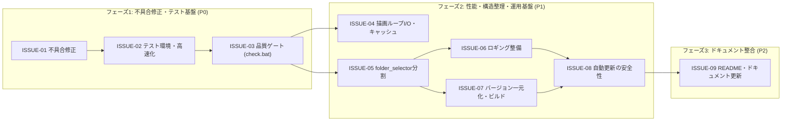

# [ロードマップ] SAP-net Visualizer 改善提案（2026-11-15）と実施計画

本ロードマップは、SAP-net Visualizer の全ソースコード・テスト・ビルド設定の精査に基づき、オーバーエンジニアリングを避けながら堅牢性・再現性・保守性を向上させるための全体計画です。

- **対象バージョン**: v1.1.0（コミット `33b83a0` 時点）
- **策定日**: 2026-11-15
- **計画方針**: 単体で完結する 9 件の Issue に分割し、フェーズごとに自律検証・実装を進める。

---

## 1. 主な課題と改善目標

1. **正しさ・安定性（P0）**: 更新ダイアログでの `NameError` クラッシュ、ログパース時の例外による後続フレーム破棄、折れ線グラフでの欠損値急落、フォルダ切替時の状態不整合を解消する。
2. **テスト実行の分離と高速化（P0）**: テストが実画面表示や本番設定ファイル（`~/.sap_visualizer/folder_history.json`）、外部通信に依存している状態を解消し、実行時間を約66秒から数秒に短縮する。
3. **描画ループ内の同期 I/O 排除（P1）**: 設定確認モーダル（`C` キー）表示中の毎フレーム（秒間30回）の YAML ファイル同期読み込みをキャッシュ化し、長大ログでのフレーム解決を $O(1)$ 化する。
4. **構造・保守性の向上（P1）**: 1,340行に肥大化した `folder_selector_gui.py` を責務別に分割し、ロギング基盤、バージョン一元管理、自動更新の安全検証（SHA-256・サイズチェック・AppMutex）を整備する。
5. **ドキュメントの整合（P2）**: README と実装の差異を解消し、テスト・品質ゲートの手順を明記する。

---

## 2. 実施順序（フェーズ別）

| 順 | Issue | 優先度 | 種別 | 規模 | 依存 | 主な変更内容 |
| :-: | :--- | :---: | :---: | :---: | :--- | :--- |
| 1 | [ISSUE-01](docs/plans/ISSUE-01_bug_fixes.md) | P0 | bug | S | なし | 更新ダイアログ未定義変数、ログパース耐性、折れ線欠損値、フォルダ切替リセットの修正 |
| 2 | [ISSUE-02](docs/plans/ISSUE-02_test_environment.md) | P0 | test | S | なし | テストの画面非表示・本番履歴分離・通信遮断、実行時間の短縮（数秒化） |
| 3 | [ISSUE-03](docs/plans/ISSUE-03_local_quality_gate.md) | P1 | quality | S | 02 | `check.bat`（ruff + pytest）と git フックの導入、既存 lint エラー 33 件の解消 |
| 4 | [ISSUE-04](docs/plans/ISSUE-04_draw_loop_perf.md) | P1 | perf | S | 03 | 設定モーダル YAML 読み込みのキャッシュ化、フレーム確定情報解決の O(1) キャッシュ化 |
| 5 | [ISSUE-05](docs/plans/ISSUE-05_folder_selector_modularize.md) | P1 | refactor | S〜M | 03 | 1,340行の `folder_selector_gui.py` を履歴・更新ダイアログ・フォルダ選択に分割 |
| 6 | [ISSUE-06](docs/plans/ISSUE-06_logging.md) | P1 | quality | S | 05 | 配布版対応のファイルロギング（`RotatingFileHandler`）と未捕捉例外フックの導入 |
| 7 | [ISSUE-07](docs/plans/ISSUE-07_version_and_build.md) | P1 | build | M | 05 | バージョン番号の単一ソース化、テンプレート化、ビルド依存分離、整合性テスト追加 |
| 8 | [ISSUE-08](docs/plans/ISSUE-08_updater_security.md) | P1 | security | M | 06, 07 | SHA-256・サイズ検証、専用一時ディレクトリ保存、AppMutex による安全な更新終了 |
| 9 | [ISSUE-09](docs/plans/ISSUE-09_docs_cleanup.md) | P2 | docs | S | 08 | README・仕様書のボタン名、設定画面解説、Linux/Docker ガイド、品質ゲート手順の更新 |

---

## 3. 全 Issue 共通の作業ルール

1. `main` ブランチには直接コミットしない。各 Issue ごとに `agy/issue-XX-<短い英語名>` ブランチを `main`（または直前マージ済みブランチ）から作成して作業する。
2. **1 Issue = 1 ブランチ = 1 PR** を原則とし、各 Issue の「**やらないこと**」に指定された範囲外の改変は行わない。
3. 判断に迷った場合は、Issue 本文の「**質問・未決事項（既定値）**」に記載された既定値に従う。
4. 各 Issue の完了時は、完了条件チェックリストをすべて検証し、変更ファイル一覧と `check.bat`（または `pytest`）の実行結果を報告する。
5. 既存の公開 API（`from sap_visualizer import ...`）の後方互換性を厳格に維持する。
6. CI サービス（GitHub Actions）は使用せず、手元のローカル品質ゲート（`check.bat`）で検査を行う。
7. ターゲット Python バージョンは **Python 3.11 以上**（`py311`）とする。

---

## 4. 進捗チェックリスト

- [x] #7 [ISSUE-01] 不具合修正
- [x] #8 [ISSUE-02] テスト環境の整備・高速化
- [x] #9 [ISSUE-03] ローカル品質ゲート導入
- [ ] #10 [ISSUE-04] 描画ループ同期 I/O 排除・キャッシュ化
- [ ] #11 [ISSUE-05] folder_selector_gui 分割
- [ ] #12 [ISSUE-06] ロギング基盤の整備
- [ ] #13 [ISSUE-07] バージョン一元管理とビルド再現性
- [ ] #14 [ISSUE-08] 自動更新の安全性向上
- [ ] #15 [ISSUE-09] ドキュメントの整合性更新
